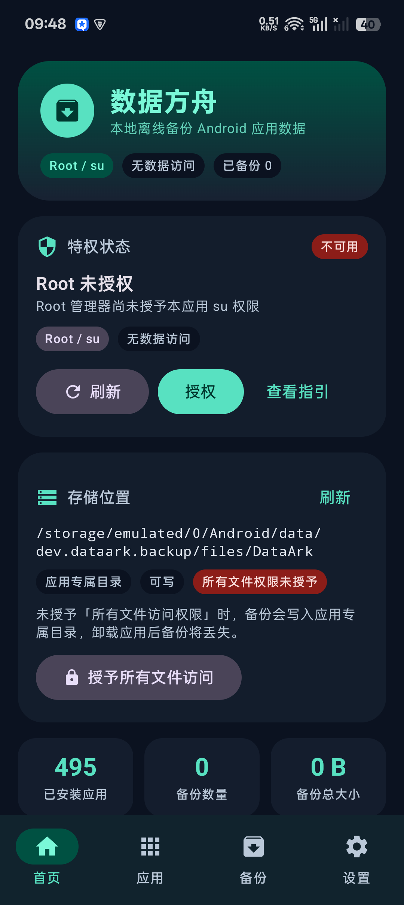
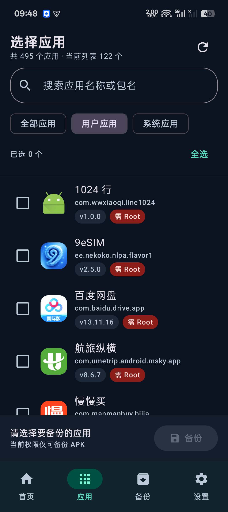
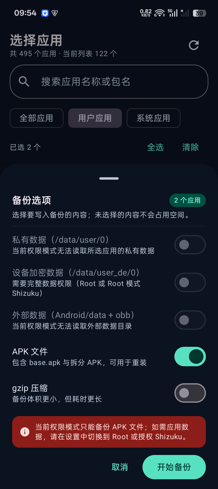
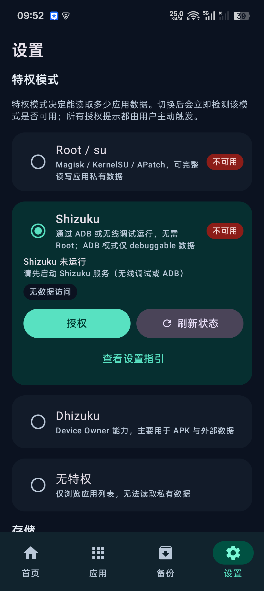

# 数据方舟 · DataArk

[](LICENSE)

一个面向 Android 的本地离线应用数据备份/恢复工具，支持 **Root**、**Shizuku**、**Dhizuku** 三种特权来源。
项目参考 [Android-DataBackup](https://github.com/XayahSuSuSu/Android-DataBackup) 的备份思路，使用 Kotlin + Jetpack Compose 独立实现。

> **核心事实**：备份其他应用的私有 `/data/data` 必须跨越 Android 沙箱。Root（或 Root 模式的 Shizuku）才能完整读取任意应用数据。
> Shizuku ADB 模式只能读取 debuggable 应用；Dhizuku 的 Device Owner 权限**不等于 root**，不能读取其他应用私有目录。
> 本应用对能力做了明确的 UI 标注和引擎侧的降级/拒绝，不会把“仅 APK”误报为“完整数据备份”。

## 功能

- 应用列表：用户/系统应用筛选、搜索、多选、异步图标、版本/调试状态徽章
- 私有数据：`/data/user/0/<pkg>`（CE）与 `/data/user_de/0/<pkg>`（DE）
- 外部数据：`/storage/emulated/0/Android/data/<pkg>`、`Android/obb/<pkg>`（仅完整权限）
- APK：base + split APK
- tar / tar.gz 归档、SHA-256 校验、meta.json 元数据
- 恢复：强制停止、原子替换/失败回滚、UID/GID、权限、SELinux 上下文修复
- 前台服务：通知栏进度、取消、后台持续
- 存储：优先 `/sdcard/DataArk`（需“所有文件访问”），否则应用专属目录（仅 APK 备份）
- Root / Shizuku / Dhizuku 授权流程、能力矩阵、ADB 配置指引

## 权限能力矩阵

| 权限来源 | 进程 UID | 任意应用私有数据 | debuggable 私有数据 | APK | 外部 Android/data、obb |
|---|---|---|---|---|---|
| Root（Magisk/KernelSU/APatch + libsu） | 0 | ✅ | ✅ | ✅ | ✅ |
| Shizuku Root 模式 | 0 | ✅ | ✅ | ✅ | ✅ |
| Shizuku ADB 模式 | 2000 (shell) | ❌ | ✅ 通过 `run-as` | ✅ | ❌（FUSE 限制） |
| Dhizuku Device Owner | Dhizuku 应用 UID | ❌ | ❌ | ✅ | ❌ |
| 无特权 | 应用 UID | ❌ | ❌ | ✅ | ❌ |

原因简述：

- **Shizuku ADB 模式**：Android 对 shell 用户执行同样的 UID/SELinux 隔离。只有 `android:debuggable="true"` 的应用可用 `run-as` 进入数据目录。外部 `Android/data` 还受 FUSE 组/包访问策略限制，因此只在完整权限下备份。
- **Dhizuku**：共享的是 Device Owner 身份（静默安装、策略、部分系统服务），`Dhizuku.newProcess` 实际运行在 Dhizuku 应用自身 UID；无法读取其他应用私有目录，也不能 `su`。
- **Shizuku Root 模式**：服务以 UID 0 启动时，能力与 Root 等价。
- **Stratum 等未开启 `android:debuggable` 的应用**：Shizuku ADB 模式无法读取其私有数据；请使用 Root 或 Root 模式 Shizuku。Root 备份会完整包含其 `/data/user/0` 与 `/data/user_de/0`。
- **外部 `Android/data` 只有 Root 能读**：Android 11+ 由 MediaProvider 的 FUSE 门禁按包名放行。实测即使持有「所有文件访问权限」的普通应用也读不到其他应用的 `Android/data`（`Permission denied`），Dhizuku 更是无法获得该权限。详见 [research/TEST-REPORT.md §9](research/TEST-REPORT.md)。

## 截图

| 首页 | 应用选择 | 备份选项 | 设置 |
|---|---|---|---|
|  |  |  |  |

截图来自 OnePlus Android 15 真机（UI 与最终构建一致）。

## 安装

本仓库只提交源码，不提交二进制：APK 由本地构建或 CI 产物提供（CI 工作流
[.github/workflows/dataark.yml](../.github/workflows/dataark.yml) 默认处于休眠状态，见下文）。

```bash
./gradlew :app:assembleRelease
adb install -r app/build/outputs/apk/release/app-release.apk
adb shell am start -n dev.dataark.backup/.MainActivity
```

- 包名：`dev.dataark.backup`，版本 1.0.0
- release 构建使用本地 debug keystore 签名，适合侧载/测试；正式发布请重新签名。

## 使用

1. 首页/设置选择特权模式并授权：
   - **Root**：点击「授权」，在 Magisk/KernelSU/APatch 中允许。
   - **Shizuku**：先启动 Shizuku 服务，再在 Shizuku 中授权本应用。
   - **Dhizuku**：设备已设置 Device Owner 后，在 Dhizuku 中授权本应用。
2. 数据备份需要「所有文件访问权限」，以便备份写到 `/sdcard/DataArk` 并让应用读取校验；仅 APK 备份可使用应用专属目录。
3. 应用页选择应用 → 「备份」→ 勾选内容（私有数据/DE/外部数据/APK/gzip）→ 开始。
4. 备份页打开快照，可校验、恢复或删除。
5. 恢复要求目标应用已安装；跨版本恢复有兼容风险，界面会提示。恢复前会先把旧数据目录移动到临时位置，失败自动回滚。

### Shizuku 启动

```bash
# 无线调试/ADB 已连接时
adb shell sh /storage/emulated/0/Android/data/moe.shizuku.privileged.api/start.sh
# 或在 Shizuku 应用内按引导启动；Root 模式可在 Shizuku 内直接启动
```

### Dhizuku 激活（Device Owner）

```bash
adb shell dpm set-device-owner com.rosan.dhizuku/.server.DhizukuDAReceiver
```

Device Owner 有且仅有一个，通常要求设备无账号/工作资料；请先阅读 Dhizuku 官方说明。

## 构建

环境：

- JDK 21
- Android SDK：`platforms;android-37.0`、`build-tools;37.0.0`
- 首次构建需联网下载 Gradle/AndroidX 依赖

```bash
cd DataArk
cat > local.properties <<'PROP'
sdk.dir=/absolute/path/to/android-sdk
PROP
export GRADLE_USER_HOME=/path/to/writable/gradle-home
export ANDROID_HOME=/path/to/android-sdk
export ANDROID_USER_HOME=/path/to/writable/android-home
./gradlew :app:assembleRelease
```

（某些沙箱中 `~/.android` 只读，必须把 `ANDROID_USER_HOME` 指到可写目录，否则 debug keystore 校验失败。）

产物：

- `app/build/outputs/apk/release/app-release.apk`
- `dist/DataArk-1.0.0.apk`（同上，已复制）

调试构建（含 `src/debug` 的 ADB 自动化 Activity/Receiver，仅用于测试）：

```bash
./gradlew :app:assembleDebug
# 需要时可用 adb 驱动，release 不包含这些组件
```

## 备份格式

```
<sdcard>/DataArk/
└── <packageName>/
    └── 20261115_114920/
        ├── data.tar          # CE + DE，已排除 cache/code_cache/lib/no_backup/.ota
        ├── external.tar      # Android/data + Android/obb（仅完整权限）
        ├── apk/
        │   ├── base.apk
        │   └── split_1.apk
        └── meta.json         # 版本、UID、模式、组件、大小、SHA-256
```

归档（Android toybox tar，绝对路径会自动去掉前导 `/`）：

```bash
tar --numeric-owner --selinux -cpf data.tar \
  /data/user/0/<pkg> /data/user_de/0/<pkg>
```

恢复（先移动旧目录，再解包到 `/`，修复 owner/mode/SELinux）：

```bash
CE_CTX=$(stat -c %C /data/user/0/<pkg>)
tar --numeric-owner --selinux -xpf data.tar -C /
chown -R <live-uid>:<live-uid> /data/user/0/<pkg>
chmod 700 /data/user/0/<pkg>
chcon -hR "$CE_CTX" /data/user/0/<pkg>   # fallback: restorecon -RF
```

`--selinux` / `--numeric-owner` 会先通过 `tar --help` 探测；旧版 toybox 不支持时自动降级为 `restorecon`。

## 项目结构

```
app/src/main/java/dev/dataark/backup/
├── core/          # 模型、应用列表、归档/恢复、存储、操作总线
├── privilege/     # libsu / Shizuku / Dhizuku 探测与 ShellRunner
├── service/       # 前台备份/恢复服务
├── ui/            # Compose UI + ViewModel
└── debug/         # 仅 debug：ADB 测试入口（release 不含）
research/          # 上游/权限/模拟器调研与测试记录
screenshots/       # 真机截图
dist/              # 构建产物
```

## 安全与限制

- 备份含隐私数据（数据库、Token、账号文件），请妥善保管；`/sdcard/DataArk` 可能被其他有存储权限的应用读取。
- 恢复会覆盖目标应用现有数据；实现有回滚保护，但仍建议先备份。
- 不备份 Android Keystore 硬件绑定密钥；恢复后依赖 Keystore 的登录状态可能需要重新验证。
- **未实现 APK 自动重装**；恢复数据前请安装同版本应用。
- 多用户（user 0 以外）、云备份、加密归档未实现。
- Dhizuku 模式仅 APK；Shizuku ADB 模式仅 debuggable 数据 + APK；外部数据仅完整权限。
- Root 端到端未在测试环境实机验证（模拟器没有 Magisk/KernelSU，AOSP `su` 不允许普通应用调用）；Root 与 Shizuku Root 模式共用同一套已验证的 tar/restore 脚本，差异仅在 libsu shell 传输层。
- 详细测试记录见 [research/TEST-REPORT.md](research/TEST-REPORT.md)。

## 致谢与许可

- 思路参考：[XayahSuSuSu/Android-DataBackup](https://github.com/XayahSuSuSu/Android-DataBackup)（GPL-3.0）
- Root shell：[topjohnwu/libsu](https://github.com/topjohnwu/libsu)（Apache-2.0）
- Shizuku：[RikkaApps/Shizuku-API](https://github.com/RikkaApps/Shizuku-API)（Apache-2.0）
- Dhizuku：[iamr0s/Dhizuku-API](https://github.com/iamr0s/Dhizuku-API)（Apache-2.0）
- Android toybox tar：AOSP（BSD）

应用图标来自 [Android-DataBackup](https://github.com/XayahSuSuSu/Android-DataBackup)（GPL-3.0），随本项目按 GPL-3.0 分发。其余资源为原创。

本项目以 **GPL-3.0-or-later** 发布，详见 [LICENSE](LICENSE)；所有 Kotlin 源文件带有 SPDX 许可头。未直接复制上游源码，仅复用了图标资源。
